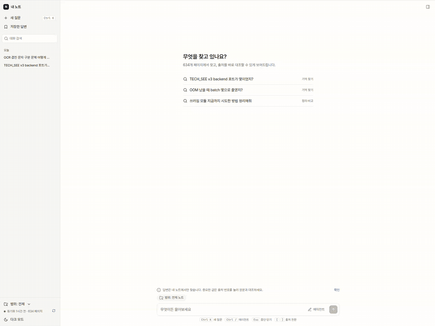
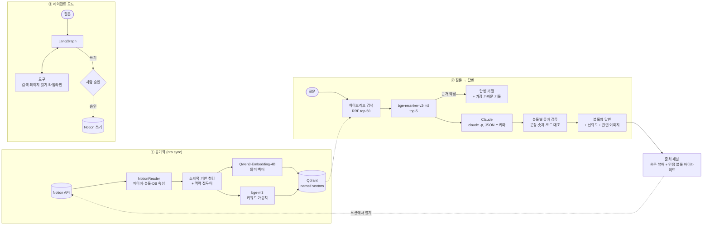
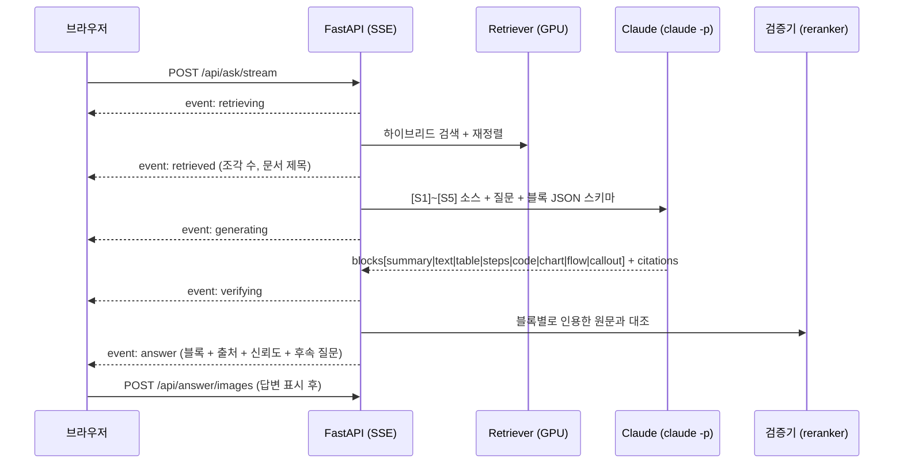
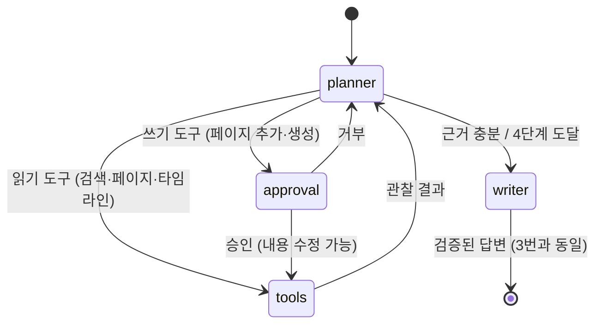

# 내 노트 — Notion RAG Agent

> **내 노션 600여 페이지에서 답을 찾고, 그 답이 어디서 왔는지 한 번에 대조할 수 있게 해 주는 개인 연구 도구**

업무 일지, 트러블슈팅, 설치 문서, 실험 기록을 노션에 몇 년씩 쌓다 보면 "그때 그 설정값 뭐였지?"가 매일 생깁니다.
노션 검색은 단어가 정확히 맞아야 찾아 주고, 범용 AI는 내 기록을 모릅니다.
이 프로젝트는 **내 노션만을 근거로 답하고, 모든 문장에 원문 위치를 달고, 근거가 없으면 지어내지 않는** 에이전트입니다.
NotebookLM의 경험을 내 노션 위에 직접 구현했습니다.



<sub>▶ 원본 영상: [docs/assets/demo.mp4](docs/assets/demo.mp4) (45초) · 질문 "OCR 겹친 문자 구분 문제 어떻게 됐어?"</sub>

---

## 한눈에 보기

| | |
|---|---|
| **무엇을** | 노션을 동기화해 색인하고, 질문하면 근거 문장 번호가 달린 답변을 만듭니다. 결론, 표, 단계, 코드, 흐름도, 관련 이미지를 블록으로 보여줍니다 |
| **차별점** | 답변의 **모든 블록을 원문과 다시 대조해 검증**합니다. 표나 차트의 숫자가 원문에 없으면 경고하고, 근거가 약하면 답하지 않습니다 |
| **스튜디오** | 선택한 범위의 노트를 통째로 읽고 **브리핑, 학습 가이드, FAQ, 타임라인, 마인드맵, 소스 가이드**를 만듭니다. 이 문서들도 답변과 같은 블록 검증을 거칩니다 |
| **메모** | 노션에 없는 사실을 브라우저 메모로 적어 두면, 질문과 관련 있을 때만 출처로 함께 씁니다 |
| **에이전트** | LangGraph로 여러 번 검색하고 페이지를 읽습니다. 노션에 쓰기 전에는 **반드시 사람의 승인**을 받습니다(인터럽트) |
| **ERP·CRM** | 로컬 **Odoo**(ERP+CRM)에 연결해 거래처, 영업기회, 주문, 재고, 송장, 구매를 조회합니다. ERP 수치와 회사 문서를 **함께 인용해** 답하고, CRM에 기록할 때는 승인을 받습니다 |
| **연동** | 읽기 전용 MCP 서버(`my-memory`)를 제공합니다. Claude Code 같은 MCP 클라이언트에서 내 노트를 검색할 수 있습니다 |
| **측정** | 자체 평가 세트로 검색 정확도와 답변 정확도를 측정합니다. Phoenix로 모든 단계를 추적(tracing)합니다 |
| **비용** | 답변 생성에는 **Claude 구독(`claude -p`)**을 쓰고, 임베딩과 재정렬은 **로컬 GPU** 모델로 돌립니다. 유료 API 키는 필요 없습니다 |

---

## 쉽게 말하면 (ELI5)

> 내 노트를 전부 읽어 둔 **사서**가 있다고 생각해 보세요.

1. **정리:** 사서는 노트를 문단 단위 카드로 잘라 둡니다. 카드마다 "어느 책, 몇 장, 어느 소제목"을 적어 둡니다. → *청킹 + 색인*
2. **찾기:** 질문을 받으면 뜻이 비슷한 카드와 단어가 겹치는 카드를 50장 뽑습니다. 그다음 질문과 한 장씩 꼼꼼히 비교해 5장만 남깁니다. → *하이브리드 검색 + 재정렬*
3. **답하기:** 그 5장만 보고 답을 씁니다. 문장마다 "이건 3번 카드에 있어요"라고 번호를 붙입니다. → *근거 기반 생성*
4. **검사하기:** 다 쓴 뒤 문장마다 정말 그 카드에 그런 내용이 있는지 다시 확인합니다. 없으면 빨간 줄을 긋고, 카드가 하나도 안 맞으면 "기록에 없어요"라고 말합니다. → *출처 검증, 답변 거절*
5. **보여주기:** 번호를 누르면 원본 노트의 그 자리를 펴서 노란 형광펜으로 표시해 줍니다. → *출처 패널*

---

## 전체 구조



- **로컬에 있는 것:** 노트 데이터, 벡터 DB, 임베딩, 재정렬, 검증은 모두 이 PC 안에 있습니다.
- **외부로 나가는 것:** 답변을 쓸 때 Claude에게 보내는 질문과 상위 조각 5개뿐입니다.
- **서버 공개 범위:** `127.0.0.1`에만 엽니다. 다른 PC에서는 접속할 수 없습니다.

---

## 어떻게 동작하나

### 1. 동기화: 노션을 "검색 가능한 카드"로

| 단계 | 구현 | 이유 |
|---|---|---|
| 수집 | `notion-client` 3.x (API 2025-09-03, data sources). 초당 약 3회로 제한하고, 429/5xx는 재시도 | 노션 API 사용량 제한을 지키기 위해 |
| 증분 동기화 | 페이지별 `content_hash`를 SQLite에 저장해, 바뀐 페이지만 다시 색인 | 600페이지 전체를 다시 색인하면 약 15분 걸림 |
| DB 행 | 데이터베이스의 속성(날짜, 상태, 태그)을 본문 앞에 텍스트 블록으로 넣음 | 본문이 빈 일지 행도 검색되도록 |
| 청킹 | 소제목 경계를 지키며 최대 1200자, 겹침 150자. 200자 미만 조각은 이웃과 병합. 코드 펜스는 쪼개도 짝을 맞춤 | 문맥이 끊기지 않고 너무 잘게 쪼개지지 않게 |
| 맥락 접두어 | `[페이지 제목 > 경로 > 소제목 \| 날짜]`를 붙여서 임베딩 | 같은 "설치 방법"이라도 어느 프로젝트의 것인지 구분 |
| 저장 | Qdrant의 named vectors(`dense` + `sparse`). 청크 id는 `sha256 → UUID`로 고정해 같은 청크를 다시 넣어도 중복되지 않음 | 재실행이나 중단 후 재시작에도 안전 |

### 2. 검색: 넓게 뽑고 정밀하게 고르기

- **하이브리드 검색:** 의미 검색(Qwen3-Embedding-4B)과 키워드 검색(bge-m3 lexical)을 Qdrant 서버 측 **RRF**로 합쳐 후보 50개를 뽑습니다.
  - 의미 검색만 쓰면 `EVENT_API_KEY`, `yolo26x` 같은 고유명사를 놓칩니다.
  - 키워드 검색만 쓰면 바꿔 말한 질문("메모리 터졌을 때")을 놓칩니다.
- **재정렬:** `bge-reranker-v2-m3` cross-encoder로 질문과 후보를 한 쌍씩 다시 채점해 5개만 남깁니다.
  - 평가에서 정답 청크 1위 비율이 **65% → 80%**로 올랐습니다(아래 평가 참고).
- **근거가 없으면 거절:** 1위 점수가 0.2 미만이면 Claude를 부르지 않고 "기록에 없음"으로 답합니다. 이때 가장 가까운 기록을 함께 보여줍니다.

### 3. 근거 기반 답변과 검증



Claude는 **도구가 꺼진 상태**(`--tools ""`, `--strict-mcp-config`)로 정해진 JSON 스키마에 맞는 답만 돌려줍니다. 나머지는 우리 코드가 처리합니다.

- **인용 정리:** 존재하지 않는 출처 번호는 버리고, 실제로 인용된 출처만 1번부터 다시 번호를 매깁니다.
- **문장 검증:** 재정렬 모델로 *답변 문장 vs 인용한 원문*을 채점합니다. ≥0.5는 근거 있음, ≥0.2는 일부 확인, 그 미만은 근거 약함(점선 밑줄)입니다.
- **숫자 검증:** 표나 차트 속 숫자가 인용한 원문에 있는지 직접 대조합니다.
  - 반올림은 허용합니다(771.8 → 772).
  - 원문에 없는 숫자는 "출처에 없는 수치"로 경고합니다.
  - Claude가 출처 번호를 빠뜨렸으면, 그 숫자가 있는 조각을 찾아 출처를 붙여 줍니다.
- **코드 검증:** 코드 블록은 줄 단위로 원문에 그대로 있는지 확인합니다.
- **신뢰도:** 검색 점수와 근거 있는 문장 비율로 `근거 충분 / 일부만 확인 / 근거 약함`을 정합니다.

> 신뢰도는 "내 노트에 근거하는가"를 뜻하며, 노트 내용 자체가 사실인지는 보장하지 않습니다.

### 4. Generative UI: 답의 모양까지 구조화

자유 형식의 마크다운 대신 **정해진 블록 타입**만 허용합니다(Structured Outputs). 화면은 React 컴포넌트 레지스트리가 블록 타입별로 그립니다.

| 블록 | 쓰임 | 화면 |
|---|---|---|
| `summary` | 결론 1~2문장 (항상 맨 위) | 강조 박스 |
| `heading` | 긴 답의 구획 | 소제목 (검증 대상 아님) |
| `text` | 문장 하나 | 본문. `**굵게**`, `` `값` `` (더블클릭하면 복사) |
| `table` / `chart` | 같은 기준의 비교 / 수치 2개 이상 | 숫자 열 오른쪽 정렬 / 가로 막대 |
| `steps` / `code` | 절차 / 명령어 | 번호 단계 / 복사 버튼 |
| `flow` | 구성요소 흐름 | 노드 카드 + 화살표 |
| `callout` | 참고, 주의, **기록 불일치** | 날짜가 다른 기록이 서로 다르면 함께 표시 |

AI가 HTML이나 JS를 직접 만들어 실행하는 아티팩트 방식은 쓰지 않았습니다. 생성된 코드 속 내용이 노트에서 왔는지 **검증할 수 없기 때문**입니다.

### 5. 관련 이미지: 재색인 없이, 확실할 때만

노션 이미지는 색인하지 않습니다. 대신 답변이 나온 뒤 **인용된 블록 주변**에서 노션 API로 찾아옵니다. 관련 없는 이미지는 없는 것보다 나쁘므로, 아래 조건을 **모두** 통과한 이미지만 넣습니다.

1. **위치:** 인용된 블록 안(토글, 컬럼)에 있거나, 같은 소제목 구간에서 2블록 이내
2. **설명:** 캡션이 있거나, 앞뒤 설명이 20자 이상 (한 단어짜리 주변 글로는 판단하지 않음)
3. **관련도:** 재정렬 모델 점수가 0.5 이상 (*그 출처를 인용한 문장 vs 캡션·소제목·주변 글*)
4. **최대 2장:** 그 문장 바로 아래에 넣습니다. 노션 파일 링크는 1시간 뒤 만료되므로 서버가 받아서 전달합니다(직접 고른 이미지만 허용).

### 6. 에이전트 모드 (LangGraph)



- **판단(planner):** Claude가 다음 행동을 JSON으로 고릅니다. 질문을 키워드로 바꿔 검색하고, 결과가 부족하면 다른 검색어로 다시 찾습니다.
- **도구 실행:** 우리 코드가 pydantic 스키마로 인자를 검증한 뒤 실행합니다. 오류는 프로그램을 멈추지 않고 "관찰 결과"로 판단 단계에 되돌립니다.
- **승인:** 쓰기 도구는 `interrupt()`로 멈추고 화면의 승인 카드를 기다립니다. 상태는 SQLite 체크포인트에 저장되므로, 서버가 재시작해도 승인 대기가 유지됩니다.
- **쓰기 범위:** 덧붙이기와 하위 페이지 생성만 허용합니다. 삭제나 보관 도구는 아예 없습니다.
- **메모리:** 같은 대화 안에서는 후속 질문을 이해합니다. "기억해"라고 하면 그 사실을 로컬 장기 기억(SQLite)에 저장합니다.

### 7. 출처 패널: 답변과 원문을 나란히

- 출처 번호를 누르면 오른쪽 패널에 노션 페이지가 열리고, **인용 블록이 하이라이트되며 자동 스크롤**됩니다.
- 반대로, 그 출처를 인용한 답변 문장들도 함께 강조됩니다.
- **불러오는 순서:** 색인된 내용을 즉시(약 10ms) 보여주고, 노션 API로 받은 최신본이 도착하면 교체합니다. 큰 페이지는 하위 블록 수만큼 API를 호출해 수십 초 걸리기 때문입니다.
- **노션 원본은 별도 창으로:** 노션은 `x-frame-options: SAMEORIGIN`이라 페이지 안에 넣을 수 없습니다. 그래서 "노션에서 열기"는 **이름이 정해진 창 하나를 재사용**합니다. OS 화면 분할로 진짜 노션과 나란히 볼 수 있습니다.

### 8. 스튜디오: 노트를 통째로 읽고 문서 만들기

질문 답변은 질문 하나에 맞는 조각 5개만 봅니다. 스튜디오는 반대로 **선택한 범위의 조각을 모두** 읽고 문서를 만듭니다(NotebookLM의 Studio).

| 문서 | 구성 |
|---|---|
| 브리핑 문서 | 결론 → 핵심 내용 → 주요 수치·결정(표) → 남은 문제 |
| 학습 가이드 | 핵심 개념 표 → 동작 원리(단계·흐름) → 복습 질문 |
| 자주 묻는 질문 | 기록으로 답할 수 있는 질문 6~10개와 답 |
| 타임라인 | 날짜·사건·비고 표. 본문 날짜가 없으면 수정일을 쓰고 "수정일 기준"이라고 밝힘 |
| 마인드맵 | 3단계 주제 트리. 노드를 누르면 그 주제로 질문 |
| 소스 가이드 | 출처 패널의 한 페이지 요약, 핵심 주제, 추천 질문 4~5개 |

- **자료 고르기:** 한 번에 읽는 양은 약 6만 자입니다. 고른 페이지가 적으면 페이지끼리 **공평하게 나눠** 큰 페이지가 나머지를 밀어내지 않게 하고, 범위가 크면 **최근 수정한 페이지부터** 읽습니다. 주제를 적으면 검색으로 관련 조각 40개만 모읍니다. 실제로 읽은 페이지 수는 화면에 표시합니다.
- **같은 검증:** 문서의 모든 블록이 답변과 똑같은 출처 검증을 거칩니다. 타임라인의 날짜도 원문(수정일 포함)에 있는지 확인합니다. 복습 질문은 주장이 아니라서 검증 비율에서 뺍니다.
- **마인드맵은 예외:** 짧은 라벨은 재정렬 모델로 판단할 수 없어 출처 번호만 달고 "문장 검증 대상 아님"으로 표시합니다.
- **잠금 범위:** 임베디드 Qdrant와 GPU 모델은 프로세스 하나만 쓸 수 있습니다. 그래서 잠금은 자료를 모을 때와 검증할 때만 잡고, 20~30초 걸리는 Claude 호출 동안에는 풀어 다른 질문을 막지 않습니다.

### 9. 스트리밍과 메모

- **결론부터 먼저:** `claude -p --output-format stream-json`으로 부분 JSON을 받아, 블록 하나가 완성될 때마다 화면에 보냅니다. 초안은 흐리게 보이고 출처 번호가 없습니다. 검증이 끝나면 확정된 답변으로 바뀝니다. 실제 질문에서 첫 블록이 **약 3초**에 보입니다(전체는 9~12초).
- **메모를 출처로:** 메모는 브라우저에만 저장됩니다. 질문할 때 함께 보내면, 서버가 노션 조각과 같은 재정렬 모델로 점수를 매겨 **답변 가능 기준을 넘는 메모만(최대 2개)** 출처로 붙입니다. 출처 패널에는 "내 메모"로 표시됩니다. 범위를 지정한 질문에는 메모를 쓰지 않습니다.
- **저장한 답변:** 노트 화면에서 모아 보고, 편집 가능한 메모로 옮길 수 있습니다.

### 10. ERP·CRM 연동 (Odoo 데모)

사내 ERP를 쓰는 상황을 재현하려고, 오픈소스 ERP인 **Odoo 18 Community**를 Docker로 띄웠습니다. 샘플 데이터(사무가구 회사)를 그대로 쓰고, 그 거래처 이름에 맞춘 **가상 회사 문서 8편**(할인 규정, 여신 규정, 재고 기준, 고객 미팅, 대리점 계약, 주간 회의, 제품 사양)을 `scenario/docs`에 두었습니다. 실제 노션에는 아무것도 쓰지 않습니다.

```
질문 ──▶ planner ──┬─▶ erp_* 도구 ──▶ Odoo XML-RPC (허용 목록 모델·필드만)
                  │        └─ 조회 결과 → 출처(Hit, erp:…) 로 변환
                  ├─▶ search_notes ──▶ 회사 문서·노트 (Qdrant)
                  └─▶ erp_log_activity ─▶ [사람 승인] ─▶ CRM 활동 등록
          writer ──▶ ERP 행 + 문서 조각을 함께 인용, 숫자는 ERP 행과 대조해 검증
```

| 설계 | 내용 |
|---|---|
| 읽기 도구 6개 | 거래처, 영업기회(확률 가중 합 포함), 판매주문(품목 포함), 재고, 송장·미수금, 구매주문 |
| 접근 제한 | `READ_FIELDS` 허용 목록에 있는 모델·필드만 읽습니다. `res.users` 같은 모델은 요청해도 막힙니다 |
| ERP 결과도 출처 | 조회 결과를 노트 조각과 같은 출처 형식으로 바꿉니다. 답변 속 금액이나 날짜가 조회한 행에 없으면 노트와 똑같이 검증에서 걸립니다 |
| 쓰기는 하나뿐 | `erp_log_activity`(영업기회에 할 일 등록)만 있고, LangGraph 인터럽트로 **승인 카드**를 거칩니다. 삭제·수정 도구는 없습니다 |
| 판단 질문 | "확정해도 돼?" 같은 질문은 규정(문서)과 그 규정이 보는 ERP 데이터(미수금, 재고 등)를 둘 다 조회하도록 플래너 규칙을 두었습니다 |

**평가 (14문항, `eval/erp_eval.py`):** ERP만 필요한 질문 5개, 문서만 필요한 질문 4개, 둘 다 필요한 질문 3개, 기록에 없는 질문 2개로 구성했습니다. 규칙 기반으로 채점해, 정답 키워드와 필요한 출처 종류(ERP/문서)를 모두 갖춰야 통과입니다.

| 버전 | 답변 정확 | 거절 정확 | 문장 근거율 | 평균 시간 | 바꾼 것 |
|---|---|---|---|---|---|
| v1 | 10/12 | 2/2 | 0.97 | 18.2초 | – |
| v2 | 11/12 | 2/2 | 0.89 | 19.9초 | ERP 출처가 있으면 판단 근거가 된 레코드를 인용하라는 지시 추가. 채점 기준 1개 완화(ERP만으로도 맞는 답) |
| v3 | 11/12 | 2/2 | 0.87 | 20.4초 | 판단 질문은 규정과 관련 ERP 데이터를 둘 다 조회하도록 플래너 규칙 추가 |
| v4 | **12/12** | 2/2 | 0.97 | 18.6초 | 도구를 하나도 안 쓰고 끝내려 하면 플래너에게 한 번 다시 묻기 |

문항이 14개뿐이라 v4의 만점은 "알려진 실패가 다 고쳐졌다" 정도로만 읽어야 합니다. 플래너가 매번 다른 길을 고르기도 해서, 실행할 때마다 1문항쯤은 달라질 수 있습니다.

**32문항으로 확장 (v4 코드 그대로):** 새 문항 18개는 v4 이후에 만들었고, 코드는 바꾸지 않았습니다. 확률 가중 합계, 최대 영업기회, 재고와 안전재고 비교(수납류·책상류), 미팅 메모 속 사양으로 재고 찾기, 수주 목록, 문서에 없는 계약·연도 질문 등입니다. 결과는 **30/30 답변 정확, 2/2 → 4/4 거절**, 문장 근거율 0.97, 평균 18.6초였습니다. 처음 보는 문항에서도 떨어지지 않아 v4 규칙이 14문항에 과적합된 것은 아니라고 봅니다. 다만 같은 사람이 데이터를 보고 만든 문항이라, 실제 사용자 질문보다 쉬울 수 있습니다.

---

## 평가

"청크를 잘 나눴는가", "질문을 이해하고 정확히 답하는가"를 수치로 확인하려고 평가 도구를 직접 만들었습니다([`eval/`](eval)).

- **평가 세트:** 실제 청크에서 Claude가 만든 질문 40개(문구를 그대로 쓰지 않고 바꿔 말함)와, 노트에 답이 없는 질문 6개입니다.
- **채점:** 검색은 정답 청크와 페이지의 순위로 Recall@k와 MRR을 계산합니다. 답변은 Claude가 참조 답과 비교해 정답, 부분 정답, 오답으로 채점합니다.

| 지표 | 기준선 | 청크·프롬프트 개선 후 | 에이전트 모드 | 블록형 답변 1단계 | 블록형 2단계 (현재) |
|---|---|---|---|---|---|
| 정답 청크 1위 (재정렬 전 → 후) | 65% → 80% | 65% → 78% | – | 65% → 78% | 65% → 78% |
| 정답 페이지 1위 | 100% | 100% | – | 100% | 100% |
| **답변 정확** | 90% | 88% | 88% | 90% | **95%** |
| 정답 + 부분 정답 | 100% | 97% | **100%** | 97% | 97% |
| 노트에 없는 질문 거절 | 100%* | 100% | 100% | 100% | 100% |
| 답이 있는데 거절한 비율 | 0% | 0% | 0% | 2.5% | 2.5% |
| 평균 응답 시간 (전체) | 6.5초 | 7.0초 | 28.5초 | 6.0초 | 7.8초 |

<sub>* 처음 측정값은 75%였습니다. 실패한 2문항을 확인해 보니, "답이 없다"고 표시한 질문인데 실제로는 노트에 답이 있었습니다(평가 데이터 오류). 그래서 두 문항을 빼고 다시 계산했습니다.</sub>

**배운 점**
- **재정렬 효과가 가장 큽니다.** 하이브리드 검색만으로는 정답 청크 1위가 65%였는데, 재정렬 후 80%가 됐습니다.
- **에이전트 모드가 항상 좋은 건 아닙니다.** 정확도는 같은데 4배 느립니다. 그래서 기본은 단일 검색으로 두고, 여러 번 찾거나 노션에 기록할 때만 에이전트를 씁니다.
- **청크 개선 효과는 측정되지 않았습니다.** 짧은 청크 병합으로 아주 짧은 청크가 29%에서 19%로, 청크 수가 2428개에서 1934개로 줄었습니다. 하지만 같은 설정을 두 번 돌렸을 때 결과가 같아 오차 범위를 재지 못했고, 정답 청크 1위 2%p 차이는 40문항 중 1문항이라 개선이라고 보기 어렵습니다.
- **블록형 2단계에서 정확도가 올랐습니다(90% → 95%, 2문항).** 결론을 맨 위에 먼저 쓰게 한 구성이 질문의 핵심 값을 놓치지 않게 한 것으로 보입니다. 다만 40문항 중 2문항 차이라 큰 개선으로 단정하지는 않습니다. 응답 시간이 늘어난 대신 스트리밍으로 첫 블록은 약 3초에 보입니다.
- **평가 데이터의 한계:** 질문을 Claude가 만들어서 실제 질문보다 쉬울 수 있습니다. 직접 쓴 질문 세트가 다음 과제입니다.

### 실험 기록 (MLflow)

평가를 돌릴 때마다 결과가 MLflow에 자동으로 기록됩니다([`eval/tracking.py`](eval/tracking.py)). 실험은 `notes-rag`(노트 검색·답변)과 `erp-agent`(ERP 에이전트) 두 개입니다.

- **무엇을 남기나:** 검색 설정(파라미터), 지표(Recall@k, MRR, 정확도, 응답 시간), 그리고 재현용 태그(git 커밋, 커밋 안 된 수정 여부, 평가 세트 해시)입니다.
- **무엇을 안 남기나:** 질문, 답변, 노트 본문은 기록하지 않습니다. 기록 저장소(`mlruns/`)는 로컬에만 있고 git에서 제외됩니다.
- 이전에 만든 결과 파일 11개도 `python -m eval.tracking backfill`로 옮겨서, 기준선부터 현재까지 한 화면에서 비교할 수 있습니다.

```bash
uv run mlflow ui --backend-store-uri sqlite:///mlruns/mlflow.db --port 5000   # http://127.0.0.1:5000
```

### 야간 파이프라인 (Airflow)

[`dags/nra_nightly.py`](dags/nra_nightly.py)가 매일 03:00에 **앱 준비 확인 → 노션 증분 동기화 → ERP 평가 → 품질 게이트**를 차례로 실행합니다.

- **Airflow는 순서만 정합니다.** GPU 모델, Qdrant, 노션·Odoo 인증 정보는 실행 중인 앱에만 있고, Airflow는 앱의 HTTP API를 호출합니다. 그래서 스케줄러에는 GPU도 비밀값도 필요 없습니다.
- **품질 게이트:** 답변 정확도가 0.85 미만이거나 기록에 없는 질문을 하나라도 지어내 답하면 실행이 실패로 표시됩니다. 결과는 MLflow에 커밋 번호와 함께 남아 어느 변경에서 떨어졌는지 바로 비교할 수 있습니다.
- 실제 1회 실행 결과: 동기화(변경 3페이지) → 평가 14/14 → 게이트 통과, 약 5분.

### 재정렬 모델 파인튜닝 (LoRA, MLflow 모델 레지스트리)

재정렬 모델(bge-reranker-v2-m3)을 내 노트에 맞게 학습시켜 보고, 운영에 넣을지 수치로 정했습니다([`training/`](training)). **결론은 "학습은 효과가 있었지만 운영에는 넣지 않음"입니다.**

1. **학습 데이터:** 노트 청크 786개에 대해 Claude가 질문을 하나씩 만들었습니다. 평가 세트(40문항)의 정답 페이지는 통째로 뺐고, 나머지 페이지를 해시로 나눠 학습 555개 / 별도 테스트 231개로 썼습니다. 페이지 단위로 나눠서 같은 페이지가 학습과 테스트에 동시에 들어가지 않습니다.
2. **어려운 오답:** 실제 운영과 같은 하이브리드 검색 상위 50개 중 **다른 페이지** 청크를 오답으로 씁니다. 같은 페이지 청크는 사실상 정답일 때가 많아 뺐습니다.
3. **학습:** LoRA(r=16)로 정답 1개 + 오답 7개 묶음에 softmax 교차 엔트로피. RTX 5080에서 3분, VRAM 3.5GB.
4. **기록과 선택:** 실행마다 MLflow에 설정·지표·문항별 승패를 남기고 `nra-reranker` 모델로 등록합니다. 두 테스트 세트 모두에서 기본 모델을 이기고, 지금까지의 최고 버전보다 나을 때만 `champion` 별칭을 옮깁니다.

| 설정 | 별도 테스트 231문항 R@1 | MRR | 문항별 승/패 | 평가 40문항 R@1 | MRR | 승/패 |
|---|---|---|---|---|---|---|
| 기본 모델 | 0.775 | 0.853 | – | 0.725 | 0.822 | – |
| 1 epoch, lr 1e-4 | 0.818 | 0.876 | 26 / 15 | 0.725 | 0.828 | 3 / 3 |
| **2 epoch, lr 5e-5 (champion)** | 0.818 | 0.881 | **30 / 10** | **0.750** | **0.839** | **4 / 0** |
| 3 epoch, r=32 | 0.823 | 0.881 | 34 / 15 | 0.725 | 0.830 | 5 / 2 |

<sub>첫 실행(2 epoch, lr 1e-4)은 평가 40문항 MRR이 기본보다 낮아(0.819) 탈락했습니다. 이 표는 학습 스크립트의 평가(최대 512토큰, bf16) 기준입니다.</sub>

**운영에 넣지 않은 이유:** champion을 실제 검색 경로(최대 1024토큰, fp16)에 꽂아 40문항을 다시 재 보니 R@1은 0.775로 **그대로**였고(2문항 상승, 1문항 하락), 점수 분포가 크게 바뀌었습니다. 기본 모델은 정답이 있는 질문의 1위 점수가 모두 0.65 이상이었는데, champion은 0.13까지 내려가 "근거 없음" 기준(0.2) 아래로 떨어지는 문항이 생겼습니다. 순위만 학습시키는 손실이라 점수의 절대값(보정)이 유지되지 않은 것입니다.

**보정 실험 (2차):** 그래서 평가를 운영과 같은 1024토큰으로 바꾸고, 게이트에 **보정 검사**를 넣었습니다. 정답 있는 질문의 1위 점수가 기준(0.2) 이상인 비율이 기본보다 떨어지거나, 답 없는 질문을 거절하는 비율이 떨어지면 탈락합니다. 학습 손실에는 정답=1, 오답=0으로 맞추는 BCE 항을 더했습니다.

| 설정 (2 epoch, lr 5e-5) | 테스트 R@1 | 평가 40 R@1 | 정답 질문 중 기준 통과 | 정답 질문 최저 점수 | 게이트 |
|---|---|---|---|---|---|
| 기본 모델 | 0.797 | 0.775 | 100% | 0.41 | – |
| 순위 손실만 | 0.831 | 0.775 | 97.4% | 0.02 | 탈락 |
| + BCE 0.5 | **0.835** | **0.800** | 98.9% | 0.14 | 탈락 |
| + BCE 1.0 | 0.831 | **0.800** | 98.9% | 0.15 | 탈락 |

- BCE를 넣자 순위는 오히려 조금 더 좋아졌고(평가 40문항 R@1 0.775 → 0.800), 점수가 바닥까지 떨어지던 문제도 많이 줄었습니다(최저 0.02 → 0.15).
- 그래도 정답 있는 질문 3개가 기준 아래로 남아 게이트를 통과하지 못했습니다. 기준을 모델마다 따로 정해 봐도(정답 질문을 모두 살리는 최대 기준) 답 없는 질문 8개 중 거절은 기본 모델 2개, BCE 1.0은 1개였습니다. **"답이 있다/없다"를 가르는 능력은 기본 모델이 더 낫습니다.**
- 그래서 운영은 기본 모델 그대로입니다. 게이트가 순위 지표만 봤다면 배포됐을 모델을 보정 검사가 막은 사례입니다.
- 덧붙여, 답 없는 질문 8개 중 5개는 기본 모델에서도 1위 점수가 0.5를 넘었습니다. 거절은 재정렬 점수보다 답변 단계의 문장 검증이 실제로 맡고 있고, 재정렬 기준값만으로는 부족합니다.

```bash
uv run python -m training.build_pairs --n 900      # 합성 질문 (claude -p)
uv run python -m training.rerank_ft all --epochs 2 --lr 5e-5 --bce 1.0   # 마이닝 → 학습 → 평가 → 게이트 → 등록 (서버 끈 상태)
```

---

## 기술 스택

| 영역 | 선택 | 고른 이유 |
|---|---|---|
| LLM | **Claude Sonnet** via `claude -p` (개인 실행) 또는 **Anthropic API** (`anthropic` SDK, 컨테이너), `LLMClient` 추상화 | 개인 사용은 구독으로, 배포는 API 키로. `LLM_PROVIDER` 한 줄로 전환하고, 구조화 출력·스트리밍 계약은 같음 |
| 배포 | **Docker** 멀티 스테이지 이미지 (UI 빌드 + CUDA 백엔드), compose `app` 프로필 | 모델 가중치는 이미지에 넣지 않고 캐시를 마운트. 비루트 사용자, 헬스체크, 호스트에는 127.0.0.1로만 공개 |
| 임베딩 (의미) | **Qwen3-Embedding-4B** | 한국어·영어가 섞인 기술 노트에 강하고, 16GB GPU에서 동작 |
| 임베딩 (키워드) | **bge-m3** lexical weights | 고유명사, 명령어, 변수명 매칭 |
| 재정렬·검증 | **bge-reranker-v2-m3** | 검색 재정렬과 답변 문장 검증에 같은 모델을 재사용 |
| 벡터 DB | **Qdrant** (임베디드 모드, named vectors, 서버 측 RRF) | 의미 벡터와 키워드 벡터를 한 컬렉션에서 하이브리드 검색 |
| 에이전트 | **LangGraph** 1.2 (interrupt, SQLite checkpointer) | 승인 대기와 재개를 그래프 상태로 안전하게 처리 |
| 도구 호출 | 자체 `ToolRegistry` (pydantic → JSON 스키마) | 어떤 도구를 실행할지 LLM 제공자에 맡기지 않음. 승인 게이트를 우회할 수 없음 |
| ERP·CRM | **Odoo 18 Community** + PostgreSQL 16 (Docker, 127.0.0.1만), 표준 XML-RPC | 실제 기업에서 쓰는 ERP의 API, 권한, 데이터 모델을 그대로 다루기 위해 |
| MCP | **mcp** 2.x `MCPServer` (stdio, 읽기 전용) | 같은 레지스트리를 외부 클라이언트에 노출 |
| 수집 | **notion-client** 3.1 (API 2025-09-03) | data sources 기반 최신 API |
| 백엔드 | **FastAPI** + SSE, `uv`, Python 3.12 | 진행 단계 스트리밍, 단일 프로세스로 모델을 한 번만 로딩 |
| 프런트엔드 | **React 19** + Vite + TypeScript, lucide 아이콘, Pretendard | 컴포넌트 레지스트리로 블록을 렌더링. 디자인 시안은 v0로 만들고 직접 이식 |
| 관측 | **Arize Phoenix** + OpenTelemetry (OpenInference) | LangGraph 노드, `claude -p`, 검색, 재정렬, 도구까지 한 트레이스로 |
| 평가 | 자체 하네스 (Recall@k, MRR, LLM 채점, 거절 정확도) | 변경 전후를 같은 기준으로 비교 |
| 스케줄링 | **Airflow** 3 (TaskFlow DAG, compose `airflow` 프로필) | 동기화·평가·품질 게이트를 매일 자동 실행. 앱 API만 호출해 스케줄러와 GPU 작업을 분리 |
| 모델 학습 | **PyTorch** + **PEFT**(LoRA), transformers | 568M 크로스 인코더를 16GB GPU에서 3분 만에 미세조정. 어댑터만 저장(수십 MB) |
| 실험 기록 | **MLflow** 3 (로컬 SQLite 저장소) | 실행마다 설정·지표·git 커밋·평가 세트 해시를 남겨 결과를 재현 가능하게 |
| 하드웨어 | RTX 5080 16GB (CUDA 12.8 wheels) | 전체 색인 시 VRAM 최대 9.6GB |

---

## 프로젝트 구조

```
src/notion_agent/
├── ingest/        노션 수집 (reader, 증분 sync, SQLite 상태)
├── rag/           청킹 · 임베딩 · Qdrant · 재정렬 · retriever
├── qa/            근거 기반 답변(grounded), 블록 검증, 스튜디오, 관련 이미지, 직렬화
├── agent/         LangGraph 그래프(planner/tools/approval/writer), factory
├── tools/         ToolRegistry + 내장 도구(검색·페이지·타임라인·쓰기·기억)
├── erp/           Odoo 클라이언트(허용 목록) + ERP 도구 6개 + CRM 활동 쓰기(승인)
├── memory/        장기 기억(profile)
├── llm/           LLMClient, claude -p 어댑터, Anthropic API 어댑터
├── observability/ Phoenix/OTel tracing
├── api/           FastAPI(SSE, 페이지 뷰어, 이미지 프록시, 에이전트 재개)
├── mcp_server.py  읽기 전용 my-memory MCP
└── cli.py         nra sync | index-docs | ask | agent | serve | mcp | doctor
web/               React UI (사이드바 · 문서형 답변 · 스튜디오 · 노트 · 출처 패널)
eval/              평가 데이터 생성 · 실행 · 청크 통계 · 결과(results.md) · MLflow 기록
training/          재정렬 모델 LoRA 파인튜닝 (합성 질문 → 오답 마이닝 → 학습 → 평가 → 레지스트리)
dags/              Airflow 야간 파이프라인 (동기화 → 평가 → 품질 게이트)
docs/              직무 분석 → 요구사항 → 스택 → 설계 문서 (01~09)
tests/             89개 (가짜 LLM·임베딩으로 GPU 없이 실행)
```

---

## 실행하기

```bash
# 0) 준비: uv, NVIDIA GPU(CUDA 12.8+), Claude Code 로그인(claude -p 사용)
curl -LsSf https://astral.sh/uv/install.sh | sh
uv sync --extra ingest --extra rag --extra api --extra trace --extra mlops
cp .env.example .env            # NOTION_TOKEN 입력 (노션 integration에 페이지 접근 권한 부여)

# 1) 노션 동기화 (처음엔 전체, 이후엔 변경분만)
uv run nra sync --full

# 2) 웹 UI
(cd web && npm install && npm run build)
uv run nra serve                # http://127.0.0.1:8000

# 3) (선택) ERP·CRM 데모: Odoo + 가상 회사 문서
docker compose up -d odoo-db odoo                # http://127.0.0.1:8069
#    .env에 ODOO_URL / ODOO_DB / ODOO_USER / ODOO_PASSWORD 설정 후, Odoo에서 DB를 샘플 데이터와 함께 만들고
#    crm · sale_management · stock · purchase · account 앱 설치
uv run nra index-docs                            # scenario/docs 색인 (서버를 끈 상태에서)
uv run nra agent "Acme Corporation 신규 주문을 지금 확정해도 돼?"
uv run python eval/erp_eval.py --label mytest    # ERP 평가 (서버 실행 중)

# 4) (선택) 컨테이너로 실행: LLM은 Anthropic API (구독 로그인은 이미지에 넣지 않음)
#    로컬 서버를 먼저 끄고 (임베디드 Qdrant 파일 잠금, GPU 메모리)
ANTHROPIC_API_KEY=... docker compose --profile app up -d --build app   # http://127.0.0.1:8000

# 5) (선택) 야간 파이프라인: Airflow UI http://127.0.0.1:8080 (관리자 비밀번호는 컨테이너 로그/standalone 파일)
docker compose --profile airflow up -d airflow   # DAG는 일시정지 상태로 등록됨. UI에서 켜거나:
docker compose exec airflow airflow dags test nra_nightly

# 그 밖에
uv run nra ask "OOM 났을 때 batch 몇으로 줄였지?"     # 터미널에서 질문
uv run nra agent "최근 Docker 관련 노트 요약해줘"      # 에이전트 모드
claude mcp add my-memory -- uv --directory $PWD run nra mcp   # MCP 등록
docker compose up -d phoenix && NRA_TRACE=1 uv run nra serve   # 트레이싱 http://127.0.0.1:6006
uv run python -m eval.build_dataset && uv run python -m eval.run_eval --tag mytest   # 평가
uv run pytest
```

| 단축키 | 동작 |
|---|---|
| `Ctrl K` | 새 질문 |
| `Ctrl /` | 에이전트 모드 |
| `Esc` | 생성 중단 / 패널 닫기 |
| `[` `]` | 이전/다음 출처 |
| `Shift` + 출처 클릭 | 노션 창에서 바로 열기 |
| 값 더블클릭 | 복사 |

---

## 한계와 다음 단계

- **이미지는 검색 대상이 아닙니다.** 텍스트로 찾은 근거 근처의 이미지만 보여줍니다. 이미지 내용까지 색인하려면 비전 모델로 설명을 만들고 재색인해야 합니다.
- **응답 시간:** 첫 블록은 약 3초에 보이지만, 검증까지 끝난 답은 9~25초가 걸립니다. 스튜디오 문서는 20~40초입니다.
- **스튜디오 범위:** 한 번에 약 6만 자만 읽습니다. 전체 노트(600여 페이지)를 고르면 최근 수정한 30페이지 안팎만 반영되므로, 폴더나 주제로 좁혀 쓰는 것이 좋습니다.
- **메모는 이 브라우저에만 있습니다.** 다른 기기와 동기화되지 않습니다.
- **청크 품질:** 본문 없이 속성만 있는 데이터베이스 행(22%)과, 코드 펜스가 잘린 것으로 나오는 청크(12%)의 원인 분석이 남아 있습니다.
- **2차 단계:** 팀원 접근(인증, 권한), GitHub 레포 연동, 로컬 LLM 라우터, 격리 환경에서 실행하는 계산·시각화 도구를 계획하고 있습니다.

## 설계 문서

이 프로젝트는 AI Agent 채용 공고 분석에서 출발했습니다. 공고에서 요구하는 역량을 기능에 하나씩 대응시키며 설계했습니다.

| 문서 | 내용 |
|---|---|
| [01 직무 분석](docs/01_AI_Agent_직무분석.md) · [03 요구사항 매핑](docs/03_요구사항_매핑_및_기능정의.md) | 채용 공고 요구 역량 → 기능(F0~F7) 대응 |
| [04 기술 스택](docs/04_기술스택_및_구조.md) · [05 재검토](docs/05_스택_재검토.md) · [06 2026 SOTA 조사](docs/06_2026_SOTA_조사.md) | 모델·DB 선정 근거 |
| [07 Tool Calling 설계](docs/07_Tool_Calling_및_로컬_라우터_설계.md) | 직접 구현한 도구 호출과 승인 게이트 |
| [08 답변 신뢰도 설계](docs/08_UI_및_답변신뢰도_설계.md) · [09 UX 화면 설계](docs/09_UX_화면설계.md) | 근거 검증 원리, 사용 시나리오, 화면 구성 |

---

<sub>개인 사용 목적의 프로젝트입니다. `claude -p`(Claude 구독)는 개인 사용에만 씁니다. 서버는 `127.0.0.1`에만 열립니다.</sub>
